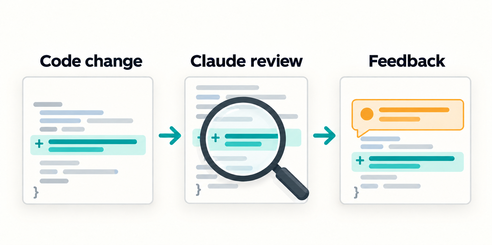

# What is Claude Review Runtime?

Claude can automatically review proposed code changes and flag potential
problems before they are accepted. Claude Review Runtime builds on Claude’s
existing review tools, giving developers a reusable way to run those reviews in
their GitHub projects and follow the results.

As the code changes, Runtime keeps track of which version Claude reviewed and
whether the review is running, finished, or failed. Developers can see whether
the review covers the latest changes without piecing together the review
history themselves.

A completed review means Claude read the captured changes and Runtime verified
the result and any attempted finding publication. It does not guarantee that
every bug was found or approve a merge.

## Next steps

- [See examples](review-presentation-gallery.md) of review progress and results.
- [Compare review approaches](choosing-a-review-approach.md) to decide whether
  Runtime fits your needs.
- [Set up Runtime](consumer-workflows.md#first-review-checklist) in your repository.
